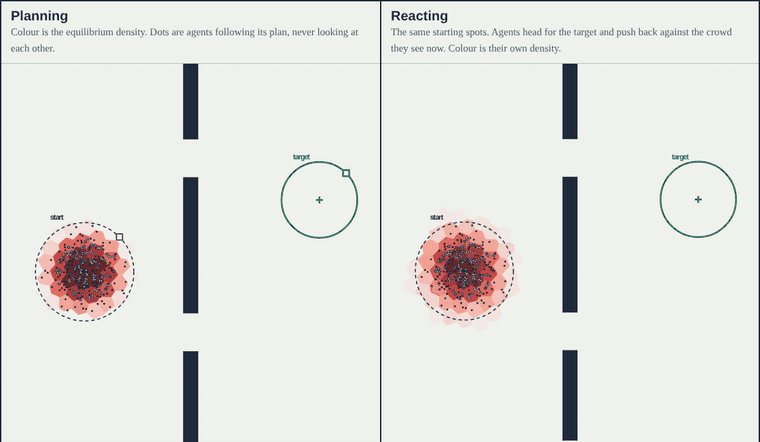

# Crowds on a Voronoi mesh

**Live site:** https://dbcav.github.io/voronoi_crowds/

Small interactive mean field games site. A mean field game models a huge crowd in which every agent plans its own route while accounting for where everyone else will be. The page solves one live, turns the solution back into individual agents, and races them against agents who only react to the crowd in front of them.

By David Cavender, applied mathematics PhD candidate at UC San Diego (optimization, mean field games, multi-agent control). [LinkedIn](https://www.linkedin.com/in/david-cavender/) · [dcavende@ucsd.edu](mailto:dcavende@ucsd.edu)
